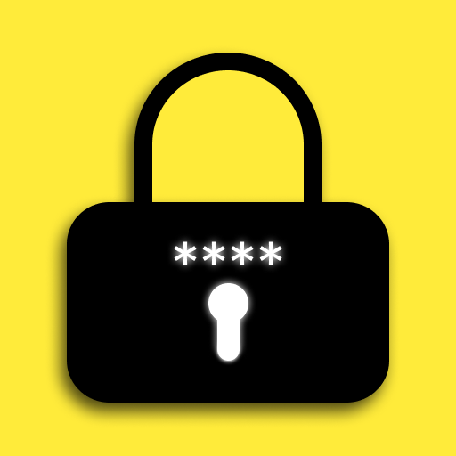
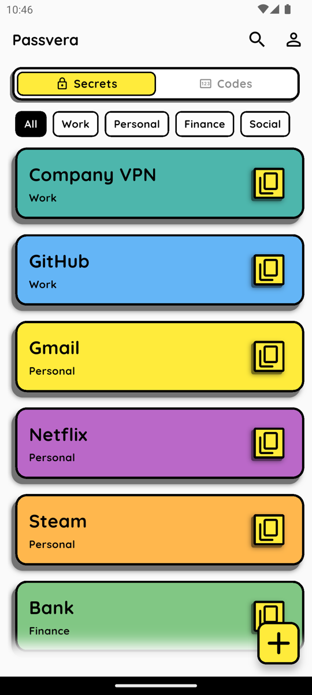
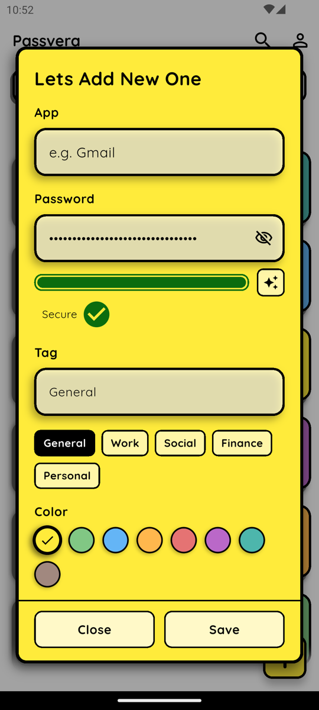
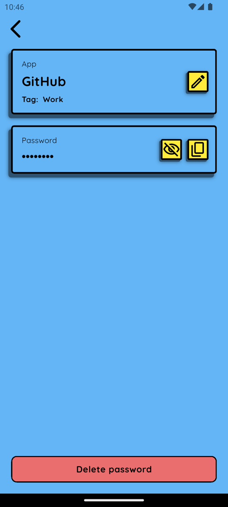
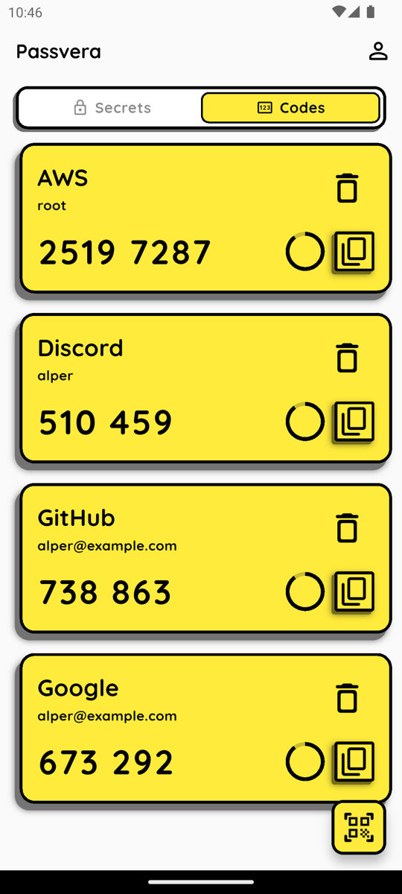

  

<h1 align="center">Passvera</h1>

  An offline password manager and authenticator with a bold, colorful look. 
  Your secrets stay on your phone. The optional Google Drive backup is end-to-end encrypted.

  

## Features

### Passwords

<table>
  <tr>
    <td width="50%" valign="top">
      <ul>
        <li>Every entry gets a <b>tag</b> and a <b>color</b>, so you can find it at a glance.</li>
        <li><b>Filter</b> the list by tag. <b>Long-press and drag</b> a tag to reorder the bar; the list follows the same order.</li>
        <li><b>Search</b> by name.</li>
        <li>Built-in <b>password generator</b> and <b>strength meter</b>.</li>
        <li><b>One-tap copy.</b> Copied secrets are marked sensitive and cleared from the clipboard after 30 seconds.</li>
      </ul>
    </td>
    <td width="25%"></td>
    <td width="25%"></td>
  </tr>
</table>

### Authenticator codes

<table>
  <tr>
    <td width="75%" valign="top">
      <ul>
        <li><b>TOTP codes</b> (SHA-1, SHA-256, SHA-512; 6 to 8 digits) with a countdown for each account.</li>
        <li>Add accounts by <b>scanning a QR code</b>.</li>
        <li><b>Move from Google Authenticator</b>: scan its export QR codes, including exports split across several codes, and pick which accounts to bring over.</li>
      </ul>
    </td>
    <td width="25%"></td>
  </tr>
</table>

### Encrypted Google Drive backup

- **Optional.** The app works fully offline without it.
- Backups are **encrypted on your phone** (AES-256-GCM) before they are uploaded. The only key is a **12-word recovery phrase** that you write down. It never leaves your phone.
- Stored in Drive's **hidden app folder**. Passvera cannot see your other Drive files.
- **Automatic**: every change is backed up shortly after you make it, and the last 10 versions are kept.
- **Restore** on a new phone, either merging with what is already there or replacing it.

### Privacy and lock

- **PIN lock** with a lockout after repeated wrong attempts. The app relocks when you leave it.
- Vault content is **hidden in the app switcher**, and Android blocks screenshots and screen recording.

---

Built with Flutter.

